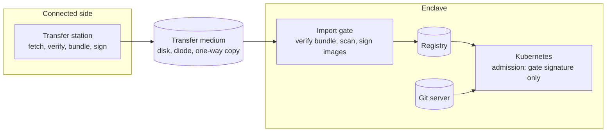

# Architecture

An air-gapped platform has three zones and one rule. Nothing inside the enclave
reaches out. Everything it runs came in through a single gate. The gate leaves
a record of what it let in.

## Connected side

The transfer station is the only machine that talks to the internet on the
enclave's behalf. It fetches what the enclave has asked for, checks each item
against its publisher's checksum or signature, packs a bundle with a manifest
and signs the bundle. It runs nothing from the enclave and keeps nothing the
enclave sent out.

What it fetches is a list kept in Git. Container images by digest, the
Kubernetes distribution's airgap artifacts, the vulnerability database, Helm
charts, OpenTofu providers and tool binaries. A request for something new is a
change to that list and gets reviewed like code.

## Transfer medium

How the bundle crosses depends on the classification. A removable disk, a
data diode or a one-way copy through an intermediate zone. The design does not
depend on which, because the gate trusts the bundle's signature and not the
medium. See [transfer.md](transfer.md).

## Import gate

The gate is the boundary in practice. It verifies the bundle signature and the
checksum of every file in the manifest. It refuses the whole bundle if either
fails. It then loads each image into the enclave registry, scans it with the
vulnerability database that came in the same bundle and signs it only if the
scan passes. The scan reports stay as evidence for every image, passed or
refused.

The gate's signing key is the root of trust inside the enclave. It belongs in
an HSM or a KMS, not on a disk next to the scripts.

## Registry

One registry inside the enclave holds every image that passed through the gate
and nothing else. Harbor if the organisation wants a UI, replication and
projects. zot or the CNCF distribution registry if it wants something small to
audit. Every node is configured to pull only from it, without a fallback to the
original registries. See [templates/rke2/registries.yaml](../templates/rke2/registries.yaml).

Workloads name the internal registry in their image references. The node would
find an image through a mirror either way, but admission fetches signatures from
the registry a pod names.

## Cluster

RKE2 is the distribution most air-gapped Kubernetes in government and defence
runs on. It ships its airgap artifacts as release assets and has a CIS profile
that enforces restricted Pod Security, default network policies and API audit
logging. See [templates/rke2](../templates/rke2).

Admission runs only images that carry the gate's signature. Everything else is
refused, whatever namespace it comes from, apart from the distribution's own
system images.

## Git server

Platform configuration and application manifests live in a Git server inside
the enclave. The cluster pulls its state from there through GitOps. That
keeps every change reviewable and gives the auditor one history to read.
Pipelines run there too, assembled from one shared set of CI components
rather than copied from project to project.

## What this does not cover

Classification rules, physical security of the transfer medium and the
organisational process that approves a transfer. Those differ per organisation
and decide more about the platform's security than any of the above.
